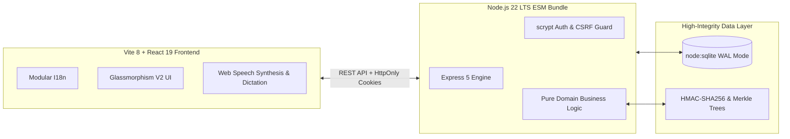

# FairShift V4.1

**Fair hours. Fair pay. Safe work.**

FairShift is a high-integrity workforce transparency, wage protection, and workplace safety platform built for employee-intensive organizations employing frontline workers in construction, infrastructure, logistics, and campus maintenance.

Built in alignment with **UN Sustainable Development Goal 8 (Decent Work and Economic Growth)**.

---

## 1. What Problems Does FairShift Solve?

| Frontline Problem                                      | What FairShift V4.1 Delivers                                                                                                                                                                                                                     |
| :----------------------------------------------------- | :----------------------------------------------------------------------------------------------------------------------------------------------------------------------------------------------------------------------------------------------- |
| **Wage Distrust & Incomprehensible Pay Tables**        | **FairShift Money Jar**: Visual liquid-layer earnings breakdown (Base, Overtime, Deductions, Net) plus an **Agreed vs Worked vs Paid** reconciliation that ordinary frontline workers can understand at a glance.                                |
| **Unresolved Wage Discrepancies & Underpaid Overtime** | **Labour Dispute Notice Generator**: One-click generation of structured, factual wage discrepancy notices backed by cryptographic work receipts, print-ready PDF styling, and authoritative Indian statutory labor frameworks.                   |
| **Severe Heat Waves & Outdoor Thermal Stress**         | **Environmental Heat Safety Assessment**: Deterministic NOAA Rothfusz Heat Index monitoring paired with **National Disaster Management Authority (NDMA)** hydration schedules, rest/shade cycles, and one-tap hazard alerts.                     |
| **Language Barriers & Limited Literacy**               | **6-Language Indian Interface**: Full support for English, Kannada (ಕನ್ನಡ), Hindi (हिन्दी), Tamil (தமிழ்), Telugu (తెలుగు), and Bengali (বাংলা) with modular asynchronous chunk loading, voice read-aloud, and speech dictation.                 |
| **Unprovable Hours & Tampered Timecards**              | **FairShift Proof**: Tamper-evident work receipts with canonical JSON serialization, HMAC-SHA256 digests, key rotation, and verifiable binary Merkle tree checkpoints.                                                                           |
| **Retaliation for Reporting Workplace Hazards**        | **Confidential Safety & Safe Signal**: Cryptographically isolated confidential reporting (`reporter_id: null`) combined with $k \ge 3$ cohort suppression to surface recurring hazard patterns without re-identifying workers.                   |
| **Unaccountable Fixes & Broken Promises**              | **FairShift Accountability Loop**: Transparent 7-stage safety lifecycle (`submitted -> acknowledged -> in_progress -> resolved -> follow_up_pending -> outcome_verified -> reopened`) with separation-of-duties and real-time MTTA/MTTR metrics. |

---

## 2. Core Feature Highlights

### 🏺 FairShift Money Jar & Earnings Transparency

- **Layered Liquid Container**: Visually maps Base Wages (primary emerald), Overtime Earnings (marigold/amber), Authorized Deductions (rose reduction indicator), and Net Payable take-home pay.
- **Color-Independent Texture**: Uses distinct SVG cross-hatching and dot patterns so the visualization never relies on color alone.
- **Agreed vs Worked vs Paid Comparison**: Side-by-side reconciliation between contracted rate/schedule, recorded shifts, and approved disbursement status.
- **Strict Integer Paise Precision**: Built directly on verified payroll math with zero floating-point rounding drift.

### 📜 Worker Labour Dispute Notice Generator

- **Factual Discrepancy Statement**: Generates an official, structured discrepancy notice summarizing attendance, hourly rates, overtime hours, and unpaid amounts.
- **Cryptographically Anchored**: Directly embeds the shift's HMAC-SHA256 receipt ID and canonical digest as an unalterable proof of record.
- **Legal Safeguards & Non-Representation Disclaimer**: Explicitly identifies the document as a worker-generated factual summary rather than legal advice, citing relevant Indian statutory frameworks (Payment of Wages Act 1936, Minimum Wages Act 1948, Code on Wages 2019).
- **Print & Text Export**: Professional letterhead styling with `@media print` PDF generation and clean text download.

### ☀️ Environmental Heat Safety & NDMA Guidelines

- **Scientifically Grounded Heat Index**: NOAA/NWS Rothfusz polynomial regression algorithm computing shaded apparent temperature from ambient temperature (°C) and relative humidity (%).
- **NDMA Occupational Tiers**: Maps heat stress into 5 standardized safety tiers (Normal, Caution, Extreme Caution, Danger, Extreme Danger) with hydration schedules (250ml per 15-20 min) and mandatory work-rest cycles.
- **Regional Indian Presets**: One-tap weather presets for Delhi Dry Heat (42°C, 25% RH), Chennai Coastal (36°C, 75% RH), Kolkata Monsoon (35°C, 80% RH), and Bengaluru Moderate (30°C, 50% RH).
- **One-Tap Hazard Link**: Directly pre-fills a heat stress report in the safety module when extreme conditions occur.

### 🌐 Modular Multilingual Architecture (6 Languages)

- **Zero-Latency Bundled English**: Base English dictionary bundled directly with the application for instant rendering.
- **Asynchronous Regional Chunks**: Kannada, Hindi, Tamil, Telugu, and Bengali loaded lazily on demand and cached in memory.
- **Full Dictionary Coverage**: Over 300 verified translation keys per language covering all worker and administrative screens.
- **Regional Number & Date Formatting**: Locale-aware currency (`formatMoney`) and calendar formatting (`formatDate`).

### 📱 Mobile Smartphone Demonstration Access

- **Instant QR Code Modal**: Evaluators and judges can click "Mobile Demo" on the login screen to scan a clean vector SVG QR code and test the frontline worker experience directly on their smartphones.
- **Zero Credential Exposure**: Never leaks test credentials or session secrets over public networks.
- **Touch-Optimized UI**: Adheres to WCAG AAA minimum 44×44px touch targets across all buttons and inputs.

---

## 3. Technology Stack & Hardened Architecture



- **Runtime**: Node.js 22.13+ LTS (`node:sqlite` built-in native driver).
- **Server Framework**: Express 5 (strict security headers, CSP, CSRF guards, signed HttpOnly cookies).
- **Frontend**: React 19, TypeScript 5.8 (Strict Mode), Vite 8, Lucide React.
- **Design Tokens**: Deep Aubergine (`#3A0F34`), Ice Silver (`#DDE3E8`), Marigold (`#EAAA00`).
- **Cryptographic Security**: HMAC-SHA256 work receipts, Merkle tree binary inclusion proofs, scrypt salted credential hashing (16-byte random salt, 64-byte key).

---

## 4. Quick Start & Demonstration

### Prerequisites

Node.js 22.13 or later.

### Installation & Development

```bash
# Clone and install dependencies
git clone <repo-url>
cd fairshift
npm ci

# Optional environment setup
cp .env.example .env

# Start local server (API + Vite dev server in one process)
npm run dev
```

Visit `http://localhost:8080`.

### Synthetic Demo Accounts (`DEMO_MODE=true`)

Every synthetic demo account uses PIN `1234`.

| Role                                      |   Industry   | Organization                       |    Phone     |
| :---------------------------------------- | :----------: | :--------------------------------- | :----------: |
| **Employer Admin** (Site Manager)         | Construction | Sunrise Infra Builders, Site 14    | `9000000100` |
| **Worker** (Mason, On Shift)              | Construction | Sunrise Infra Builders, Site 14    | `9000000001` |
| **Worker** (Helper)                       | Construction | Sunrise Infra Builders, Site 14    | `9000000002` |
| **Worker** (Electrician, Fatigue Alerts)  | Construction | Sunrise Infra Builders, Site 14    | `9000000003` |
| **Employer Admin** (Facilities Officer)   |  Education   | Greenfield Institute of Technology | `9100000100` |
| **Worker** (Housekeeping)                 |  Education   | Greenfield Institute of Technology | `9100000001` |
| **Worker** (Security Guard, Night Shifts) |  Education   | Greenfield Institute of Technology | `9100000002` |

To reset and re-seed the local demo database at any time:

```bash
npm run seed
```

---

## 5. Quality, Security & Verification Commands

```bash
# Run comprehensive automated test suite (Unit, Integration, Adversarial & UI)
npm test

# Run strict TypeScript compiler verification
npm run typecheck

# Run ESLint (zero errors, zero warnings enforced)
npm run lint

# Check code formatting consistency (Prettier)
npm run format:check

# Compile dual production bundles (Vite client + esbuild server)
npm run build
```

---

## 6. Detailed Technical Documentation

- **[V4.1 Product Enhancements Plan](file:///D:/College/SOMESHIT%20DOWNLOADS/ACM/docs/V41_PRODUCT_ENHANCEMENTS.md)**
- **[Worker Earnings Experience & Money Jar](file:///D:/College/SOMESHIT%20DOWNLOADS/ACM/docs/V41_WORKER_EARNINGS_EXPERIENCE.md)**
- **[Worker Labour Dispute Notice Assistance](file:///D:/College/SOMESHIT%20DOWNLOADS/ACM/docs/V41_WAGE_DISPUTE_ASSISTANCE.md)**
- **[Multilingual Architecture & Localization System](file:///D:/College/SOMESHIT%20DOWNLOADS/ACM/docs/V41_LOCALIZATION.md)**
- **[Environmental Heat Safety & NDMA Assessment](file:///D:/College/SOMESHIT%20DOWNLOADS/ACM/docs/V41_ENVIRONMENTAL_SAFETY.md)**
- **[Mobile Worker Experience & Touch Refinements](file:///D:/College/SOMESHIT%20DOWNLOADS/ACM/docs/V41_MOBILE_REFINEMENTS.md)**
- **[Contractor & Subcontractor Architecture Proposal](file:///D:/College/SOMESHIT%20DOWNLOADS/ACM/docs/CONTRACTOR_SUBCONTRACTOR_PROPOSAL.md)**
- **[Cloud Run Deployment Runbook](file:///D:/College/SOMESHIT%20DOWNLOADS/ACM/docs/DEPLOYMENT_RUNBOOK.md)**
- **[V4.0 Final Release Sanity Check](file:///D:/College/SOMESHIT%20DOWNLOADS/ACM/docs/V40_FINAL_SANITY_CHECK.md)**

---

## 7. License

MIT License. Designed and engineered for sustainable workforce accountability.
