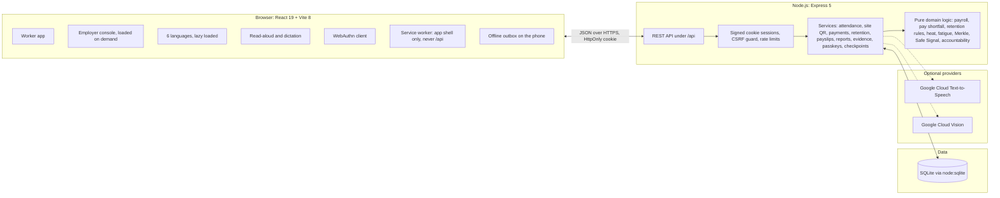

# FairShift

**Fair hours. Fair pay. Safe work.**

FairShift is a workforce platform for frontline workers on construction sites and in campus support services (housekeeping, security, sanitation, maintenance). Workers check in and out (also by scanning a rotating site QR code, and offline when the site has no signal), see exactly what they earned and whether what was paid matches, report hazards (openly or confidentially, with photos) and follow each report until the fix is confirmed. Employers get a console for the workforce, shifts, pay, recorded payments, safety reports, fatigue alerts, a rule-based retention attention panel and an audit log. It installs as an app on a phone and comes in Light, Dark and Night appearances.

It is built around UN Sustainable Development Goal 8 (Decent Work and Economic Growth): provable working hours, transparent wages and accountable safety fixes.

**Live demo:** <https://fairshift-nine-red.vercel.app>. It runs on synthetic data that resets (see [Deployment](#9-deployment)).

---

## Contents

1. [The problems FairShift addresses](#1-the-problems-fairshift-addresses)
   - [Feature mapping](#feature-mapping)
2. [Try the demo](#2-try-the-demo)
3. [Features for workers](#3-features-for-workers)
4. [Features for employers](#4-features-for-employers)
5. [Trust and integrity: FairShift Proof, Safe Signal, the Accountability Loop](#5-trust-and-integrity)
6. [Architecture](#6-architecture)
7. [Project structure](#7-project-structure)
8. [Running locally](#8-running-locally)
9. [Deployment](#9-deployment)
10. [Configuration reference](#10-configuration-reference)
11. [Security and privacy](#11-security-and-privacy)
12. [Testing and quality checks](#12-testing-and-quality-checks)
13. [Known limitations](#13-known-limitations)
14. [Further documentation](#14-further-documentation)
15. [Screenshots](#15-screenshots)
16. [License](#16-license)

---

## 1. The problems FairShift addresses

| Problem on the ground                                           | What FairShift does                                                                                                                                                                    |
| :-------------------------------------------------------------- | :------------------------------------------------------------------------------------------------------------------------------------------------------------------------------------- |
| Hours are disputed and timecards can be edited after the fact   | Every completed shift produces a signed work receipt (HMAC-SHA256) that can be checked later; receipts are anchored in Merkle-tree checkpoints. Corrections are audited.               |
| Pay slips are hard to read, so underpayment goes unnoticed      | The **Money Jar** shows base pay, overtime, deductions and net pay as layers, next to an **agreed vs worked vs paid** comparison. All money is integer paise, no rounding drift.       |
| Workers who notice a pay gap have no structured way to raise it | The **wage discrepancy notice generator** produces a factual, printable notice that cites the work receipt and the relevant Indian wage laws, and says clearly it is not legal advice. |
| Hazard reports are ignored, or "fixed" on paper only            | The **Accountability Loop** tracks every report through a fixed lifecycle; reports with photos need a photo of the fix and the reporter's confirmation (**two-key closure**).          |
| Workers fear retaliation for reporting                          | **Confidential reports** store no reporter identity; **Safe Signal** shows recurring hazard patterns only when at least three reports agree, so no single reporter stands out.         |
| Extreme heat on outdoor sites                                   | A **heat-stress check** computes the heat index (NOAA Rothfusz) and maps it to NDMA-style guidance on water, rest and shade, with a one-tap link to report heat as a hazard.           |
| Many workers read little English, or read little at all         | The interface is fully translated into **six languages** (English, Hindi, Kannada, Tamil, Telugu, Bengali), with **read-aloud** and **voice dictation**.                               |
| Buddy punching (one worker checking in for another)             | Optional **passkey check-in** (WebAuthn): the worker's own phone confirms check-in and check-out with its screen lock. No fingerprint or face data ever leaves the phone.              |
| A static gate code can be shared or photographed                | **Rotating site QR check-in:** a signed, site-bound code that changes every 30 s, expires by the server's clock and works once per worker, on top of the sign-in and passkey.          |
| Underpayment is only noticed if someone does the sums           | The **possible pay shortfall indicator** compares verified hours at the configured rate with payments the employer recorded, shows the arithmetic and flags gaps for review.           |
| Sites often have no mobile signal                               | An **installable app** that opens offline and keeps check-ins and reports on the phone, labelled _pending verification_ until the server confirms them.                                |
| Employers notice problems only after people leave               | A **retention attention panel**: fixed, visible rules over overtime, open alerts, record corrections, unresolved reports and pay gaps, with reasons and follow-ups. Not a prediction.  |

### Feature mapping

How each need maps to what FairShift does, where it lives and what tests it. Paths are under `src/` and `tests/`.

| Need                                   | FairShift functionality                                                                                 | Pages                                                            | Source modules                                                                                                           | Tests                                                                                                        |
| :------------------------------------- | :------------------------------------------------------------------------------------------------------ | :--------------------------------------------------------------- | :----------------------------------------------------------------------------------------------------------------------- | :----------------------------------------------------------------------------------------------------------- |
| Provable working hours                 | Server-timed check-in/out, signed work receipts, Merkle checkpoints, audited corrections                | Worker Home, Attendance; console Shifts                          | `server/services/attendance.ts`, `server/services/receipts.ts`, `domain/merkle.ts`, `domain/proof.ts`                    | `unit/attendance`, `unit/proof*`, `unit/merkle`, `integration/proof`, `integration/workflows`                |
| Check-in that cannot simply be shared  | Rotating site code; **rotating, signed, site-bound QR** (expiry, nonce, one use per worker); passkeys   | Worker `/c/<token>`, time card "Scan site QR"; console Sites     | `server/auth/siteQr.ts`, `server/services/siteQr.ts`, `server/services/passkeys.ts`, `client/components/SiteQrPanel.tsx` | `integration/qr-attendance`, `integration/passkeys`, `unit/site-code`, `client/final-update`                 |
| Transparent wages                      | Money Jar, agreed vs worked vs paid, line-by-line payslips, integer paise                               | Worker Pay, payslip view; console Payslips                       | `domain/payroll.ts`, `domain/moneyJar.ts`, `shared/money.ts`                                                             | `unit/payroll`, `unit/money-jar`, `unit/time-money`                                                          |
| Spotting underpayment                  | **Possible pay shortfall indicator** and **recorded payments** (append-only), with the full calculation | Worker Pay check, Home; console Pay check                        | `domain/payShortfall.ts`, `server/services/payments.ts`, `client/components/PayCheck.tsx`                                | `unit/pay-shortfall`, `integration/pay-check-retention`, `client/final-update`                               |
| Raising a wage dispute                 | Wage discrepancy notice citing receipts, with legal disclaimers                                         | Worker payslip view                                              | `domain/dispute.ts`, `client/components/DisputeNoticeModal.tsx`                                                          | `unit/dispute-notice`                                                                                        |
| Safe work and fixes that really happen | Hazard reports with photos, confidential reporting, Accountability Loop, two-key closure, Safe Signal   | Worker Safety; console Safety reports, Photo inspections         | `server/services/reports.ts`, `server/services/evidence.ts`, `domain/signal.ts`, `domain/accountability.ts`              | `integration/accountability`, `integration/safety-evidence`, `integration/signal`, `unit/signal*`            |
| Fatigue and heat                       | Excessive-hours alerts, heat-stress check                                                               | Worker Home, Safety; console Hours alerts                        | `domain/fatigue.ts`, `domain/heat.ts`                                                                                    | `unit/safety-fatigue-feedback`, `unit/heat`                                                                  |
| Keeping people (decent work)           | **Retention attention panel**: rule-based, explained, read-only, never punitive                         | Console Retention attention, Dashboard                           | `domain/retention.ts`, `server/services/retention.ts`, `client/pages/admin/Retention.tsx`                                | `unit/retention`, `integration/pay-check-retention`                                                          |
| Sites with poor connectivity           | **Installable PWA**, offline shell, outbox for check-ins and reports, update prompt                     | Whole worker app; offline banner and "Saved on this phone" sheet | `client/pwa/sw.js`, `client/pwa/plugin.ts`, `client/lib/outbox.ts`, `client/lib/outboxContext.tsx`, `client/lib/pwa.ts`  | `unit/pwa`, `client/outbox`, `client/pwa-register`, `client/final-update`, `integration/pay-check-retention` |
| Language and literacy                  | Six languages, read-aloud, dictation; Light, Dark and Night appearances                                 | Every worker screen; Appearance and Language buttons             | `client/lib/i18n.tsx`, `client/lib/speech.ts`, `client/lib/theme.tsx`, `client/styles/themes.css`                        | `unit/i18n`, `unit/speech`, `unit/themes`, `unit/design-tokens`                                              |
| Privacy and security                   | Tenant isolation, signed sessions, CSRF guard, rate limits, metadata stripping, append-only logs        | All                                                              | `server/auth/*`, `server/app.ts`, `server/db/schema.ts`                                                                  | `unit/*-adversarial`, `integration/session-revocation`, `integration/login-throttle`, `unit/append-only`     |

Quality areas and where the evidence is:

| Area                  | Evidence                                                                                                                           |
| :-------------------- | :--------------------------------------------------------------------------------------------------------------------------------- |
| Working functionality | The live demo, the [five-minute tour](#2-try-the-demo), and 450 automated tests that drive the real API and the real React client  |
| Security and privacy  | [Security and privacy](#11-security-and-privacy), [docs/SECURITY.md](docs/SECURITY.md), the adversarial test files                 |
| Accessibility         | 44 px targets, WCAG contrast checked in tests for all three themes, reduced-motion and reduced-transparency support, jsx-a11y lint |
| Honest limits         | [Known limitations](#13-known-limitations): what is not persistent, not proven, or not translated                                  |
| Deployment            | [Deployment](#9-deployment): Vercel Build Output API, Dockerfile                                                                   |

---

## 2. Try the demo

Open <https://fairshift-nine-red.vercel.app> and sign in with any of the synthetic accounts below. **Every account uses PIN `1234`.** The sign-in page also lists the demo accounts, and a "Mobile demo" button shows a QR code to open the site on a phone.

| Role             | Organisation (synthetic)                       | Name           | Job                    | Phone        |
| :--------------- | :--------------------------------------------- | :------------- | :--------------------- | :----------- |
| Employer (admin) | Sunrise Infra Builders, Site 14 (construction) | Priya Raman    | Site manager           | `9000000100` |
| Worker           | Sunrise Infra Builders, Site 14                | Ravi Kumar     | Mason                  | `9000000001` |
| Worker           | Sunrise Infra Builders, Site 14                | Lakshmi Devi   | Helper                 | `9000000002` |
| Worker           | Sunrise Infra Builders, Site 14                | Mohammed Irfan | Electrician            | `9000000003` |
| Worker           | Sunrise Infra Builders, Site 14                | Suresh Naik    | Scaffolder             | `9000000004` |
| Employer (admin) | Greenfield Institute of Technology (campus)    | Anita Desai    | Facilities officer     | `9100000100` |
| Worker           | Greenfield Institute of Technology             | Manjula S      | Housekeeping staff     | `9100000001` |
| Worker           | Greenfield Institute of Technology             | Ramesh Gowda   | Security guard         | `9100000002` |
| Worker           | Greenfield Institute of Technology             | Fatima Begum   | Sanitation worker      | `9100000003` |
| Worker           | Greenfield Institute of Technology             | Venkatesh R    | Maintenance technician | `9100000004` |

A suggested five-minute tour:

1. **As Ravi (worker, `9000000001`):** look at the time card on the home screen, open **Pay** to see the Money Jar and the agreed vs worked vs paid comparison, open a payslip and generate a discrepancy notice, then open **Safety** and report a hazard with a photo. Switch the language to Tamil or Hindi and press **Read aloud**.
2. **As Priya (admin, `9000000100`):** open the dashboard, the safety report queue and the report Ravi just filed; acknowledge it, add a photo of the fix and mark it resolved. Look at **Photo inspections**, **Excessive-hours alerts** and the **Audit log**.
3. **Back as Ravi:** confirm or dispute the fix. The report can only be verified after that.
4. **QR check-in:** as Priya, open **Sites & QR check-in**, choose **QR check-in** on a site and **Start QR check-in**. Sign in as Lakshmi (`9000000002`) on a phone and scan the code with the camera (or **Scan site QR** on the time card): FairShift shows which site it is and checks in only when she confirms.
5. **Pay check:** as Lakshmi, open **Pay**: the **Pay check** compares her verified hours with the payment recorded for last week and shows the possible shortfall. As Priya, open **Pay check** to see every worker's status and record a payment, then **Retention attention** to see who may need follow-up and why.
6. **Offline and appearance:** install FairShift from the browser menu, switch the phone to airplane mode and check in: the check-in is saved as _pending verification_ and sent when the connection returns. Use the moon/sun button in the top bar to switch between System, Light, Dark and Night.

The two organisations are fully separated: an admin of one never sees the other's workers, reports or photos.

---

## 3. Features for workers

### Time card and attendance

- Check in and check out from the home screen. Timestamps always come from the server, never the phone.
- Check-in can require the 6-digit **site code** shown on the employer's console. It rotates every five minutes, so a worker must have seen the current code (it proves presence at the gate display, not GPS location).
- Shift history with each shift's hours and its signed **work receipt**, which can be opened and verified.
- **Site QR check-in:** scan the rotating QR code on the site screen with the phone camera or with **Scan site QR** on the time card. FairShift shows the site name and the code's expiry, and records nothing until the worker confirms. The server checks the signature, the site, the expiry by its own clock, that the display is still running and that this worker has not used this code before; the worker's sign-in (and passkey, if they have one) is still required. Shifts started this way show the site in the history.
- **Passkey check-in (optional):** once a worker adds a passkey under _More → Passkey for check-in_, check-in and check-out each ask the phone to confirm with its own screen lock (fingerprint, face or PIN). A worker can hold up to five passkeys and remove a lost phone; an employer can reset them. Workers without a passkey simply use their sign-in.

### Pay and the Money Jar

- **Money Jar:** a layered visual of base pay, overtime, deductions and net pay. Layers use patterns as well as colour, so the chart never relies on colour alone.
- **Agreed vs worked vs paid:** contracted rate and schedule, recorded hours, and what was paid, side by side, with any gap stated in rupees.
- Payslips with a full line-by-line breakdown and a preview of the current period.
- All money is stored and computed in integer paise.
- **Pay check (possible pay shortfall indicator):** for a payslip period, this month or last month, it shows expected earnings (closed shifts at the worker's configured rate, overtime and deductions exactly as on a payslip), the payments the employer recorded, and the difference: _No discrepancy identified_, _Possible shortfall_ (under 10% of expected), or _Payment discrepancy requires review_ (10% or more, or nothing recorded). The calculation is shown step by step. Without a configured rate it says the amount cannot be calculated reliably. It applies no statutory minimum wage (rates vary by state, sector, category and date), is not a legal finding, and never moves money.

### Wage discrepancy notice

- Generates a structured notice from the worker's own records: dates, hours, rate, overtime and the unpaid amount.
- Embeds the work receipt ID and digest so the employer can check the hours against the original record.
- Cites the Payment of Wages Act 1936, the Minimum Wages Act 1948 and the Code on Wages 2019, and states that it is a factual summary, not legal advice.
- Print-ready (`@media print`) and downloadable as text.

### Safety reporting

- Report a hazard with a category, severity, location, description and per-industry inspection points (helmet, vest, footwear, electrical, fire or smoke, machinery, chemicals, heat and others).
- **Photos:** "Take a photo" uses the phone's own camera app; "Choose a photo" opens the gallery. Up to six photos per report, each with a note; preview, retake and remove before sending. Photos are optional, so a missing camera never blocks a report.
- Photos are turned upright, resized to 1600 px and re-encoded on the phone, which removes location and device metadata before upload. The server strips any remaining metadata again.
- **Confidential reports:** the reporter's identity is not stored at all.
- Each report has a case page with its lifecycle, before and after photos side by side, and a "Check the seal" button for every photo.
- **"Is it fixed?":** when an employer marks a photo-backed report resolved, the reporter confirms the fix or says what is still wrong, which reopens the report.

### Heat-stress check

- Enter temperature and humidity, or pick a regional preset (Delhi dry heat, Chennai coastal, Kolkata monsoon, Bengaluru moderate).
- The NOAA/NWS Rothfusz heat index maps to five tiers (normal to extreme danger) with water, rest and shade guidance.
- One tap pre-fills a heat hazard report when conditions are dangerous.

### Language, read-aloud and dictation

- Six languages: English, Hindi (हिन्दी), Kannada (ಕನ್ನಡ), Tamil (தமிழ்), Telugu (తెలుగు) and Bengali (বাংলা). English is bundled; the others load on demand.
- **Read aloud:** chooses a voice for the selected language only (never reads Tamil with an English voice), reads sentence by sentence, and offers pause, resume, stop, replay, speed (0.75×, 1×, 1.25×) and voice choice.
- If the device has no voice for a language, it says so plainly and explains how to add one. If `GOOGLE_TTS_API_KEY` is configured, the server provides the voice instead.
- **Dictation:** speak into report and feedback fields where the browser supports speech recognition.

### Offline and installable app

- FairShift is a Progressive Web App: a web app manifest, app icons (including a maskable icon), standalone display and a service worker. It can be installed from the browser and opens without a connection once it has been used online.
- **Offline outbox:** a check-in, check-out or safety report made without a connection is saved on the phone and shown as _Waiting to send_ / _Pending verification_. It is sent automatically when the connection returns; each item then shows _Recorded by FairShift_, _Needs you_ (expired sign-in, or a passkey confirmation that needs the person), _Not added: already recorded_ or _Not sent_ with **Try again** and **Remove**.
- Nothing saved offline counts until the server confirms it. A saved check-in is recorded at the time the server receives it; the phone's own time is kept in the audit log, marked as unverified, for the supervisor to review. Reports carry a random request ID so a retried report is stored once. QR check-in needs a connection (codes expire within a minute).
- Report forms are saved as a draft while typing. Photos are not stored offline.
- The service worker caches only the application shell and static files. It never caches `/api` responses, so pay, records, sessions and passkey challenges are never stored by it. Signing out deletes anything unsent from the phone, after a warning.
- When a new version is deployed, a banner offers **Update now**; nothing reloads by itself.

### Appearance

- **System** (follows the phone), **Light**, **Dark** and **Night**, from the round button in the top bar of both the worker app and the console. The choice is kept on the device and applied before the first paint, so the wrong theme never flashes.
- Dark is deep aubergine-black glass with clear card edges. Night is dimmer and warmer for night shifts and long reading: no pure white text, a dimmed marigold, a quieter background and fewer glows. All three keep the brand (Deep Aubergine `#3A0F34`, Ice Silver `#DDE3E8`, Marigold `#EAAA00`) and the Glassmorphism V2 materials, and their text contrast is checked in tests.

### More

- Notifications (shift, pay and report updates), a skills passport with employer-verified skills, and ratings or comments as feedback to the employer.

---

## 4. Features for employers

The console loads only when an administrator signs in, so the worker app stays small.

- **Dashboard:** workforce on shift, hours this week, open safety reports, alerts and accountability metrics (time to acknowledge, time to resolve).
- **Workforce:** add workers, set rates, activate or deactivate (deactivation signs the worker out everywhere immediately), verify skills, reset a worker's passkeys.
- **Sites & QR check-in:** sites and locations, the organisation's rotating 6-digit check-in code, and per site a **rotating QR display** for a phone, tablet or screen at the entrance: a visible countdown, **New code now**, **Full screen**, **Stop**, active/inactive status, today's QR check-ins and instructions. Starting and stopping are audited.
- **Retention attention:** counts of workers at _Low_, _Moderate_ and _High_ attention, search, level filter, sorting, and a detail view per worker with each triggered rule, the records behind it (with links) and suggested follow-up. Rules (last 30 days): overtime days, open hours alerts, corrected or over-long shifts, named safety reports still unresolved or disputed, and issued pay periods with a recorded pay gap. Confidential reports and anonymous feedback are never attributed; wage dispute notices are not stored, so they are not counted. It is read-only, says it is not a prediction, and never changes wages, attendance or employment status.
- **Pay check and recorded payments:** every worker's expected pay, recorded payments and possible shortfall for a period, with status tiles, search and filters; the full calculation per worker; and a form to record a payment made outside FairShift (cash, bank transfer, UPI, cheque). Payment records are append-only (corrections are adjustments with a reason) and audited. FairShift never transfers or deducts money.
- **Shifts:** all attendance records, with audited corrections.
- **Safety report queue and case view:** move reports through the lifecycle, add fix photos, review the advisory photo analysis, see Safe Signal patterns.
- **Photo inspections:** every report with photos, with before/after thumbnails, advisory outcomes, pending reviews and the state of each two-key closure.
- **Excessive-hours alerts:** fatigue and rest-period warnings computed from shift data.
- **Payslips and pay rules:** issue payslips, export the wage register as CSV (protected against spreadsheet formula injection), set overtime and working-hour rules.
- **Feedback** from workers, and an append-only **audit log** of every significant action.

---

## 5. Trust and integrity

### FairShift Proof

- Every completed shift produces a **work receipt**: canonical JSON of the shift, signed with HMAC-SHA256 under a key ID, so signing keys can be rotated without breaking older receipts.
- Receipts are grouped into **Merkle-tree checkpoints**; a receipt's inclusion proof can be checked against a checkpoint.
- Safety photos get the same treatment: a SHA-256 of the stored bytes plus an HMAC seal over the evidence record. A database trigger refuses any change to a stored photo, its hash or its seal.
- What a seal means is stated plainly in the interface: the photo has not changed since upload. It does not prove the photo shows a true event.

### Safe Signal

- Surfaces recurring hazard patterns across reports while suppressing any group smaller than three (k ≥ 3), so a pattern can never be traced back to one person.
- Uses a dedicated pseudonym secret, separate from session signing.

### Accountability Loop

- Reports follow a fixed state machine: `submitted → acknowledged → in_progress → resolved → follow_up_pending → outcome_verified`, with `reopened` when a fix fails.
- **Two-key closure** for reports with photos: resolving needs a photo of the fix; the reporter then confirms or disputes. If the reporter does not answer within 24 h (critical), 48 h (high) or 72 h (other), only a _different_ administrator from the one who resolved it can close the report (separation of duties), and the closure is recorded as escalated.
- Optional **advisory photo analysis** (Google Cloud Vision, when `GOOGLE_VISION_API_KEY` is set) flags possible fire or smoke, machinery or missing protective gear for a person to confirm or dismiss. Results are always labelled advisory, and "no visible issue" never means "safe". Without a key, every photo simply goes to manual review.

---

## 6. Architecture



| Layer    | Technology                                                                                                         |
| :------- | :----------------------------------------------------------------------------------------------------------------- |
| Runtime  | Node.js 22.13 or later (uses the built-in `node:sqlite` driver; no native modules)                                 |
| Server   | Express 5, Zod 4 validation, esbuild bundle                                                                        |
| Client   | React 19, TypeScript (strict), Vite 8, Lucide icons, self-hosted variable fonts                                    |
| Data     | SQLite in WAL mode; schema applied at start-up with additive, non-destructive migrations                           |
| Auth     | Phone + PIN (scrypt, random salt), signed HttpOnly session cookies with versioned revocation; optional OAuth / OTP |
| Passkeys | SimpleWebAuthn 14 (server and browser)                                                                             |
| Hosting  | Vercel (static client + one Node.js function via the Build Output API); a Dockerfile is kept for container hosts   |
| Tests    | Vitest 5, Supertest, happy-dom                                                                                     |

Design choices worth knowing:

- **Business rules are pure functions** in `src/domain` (payroll, heat index, fatigue, Merkle trees, Safe Signal, the accountability state machine), so they are tested without a server or database.
- **All SQL uses named parameters** through a thin wrapper (`src/server/db/db.ts`); no SQL is built from strings.
- **Tenant isolation:** every query is scoped to the signed-in user's organisation; cross-organisation access returns 404.
- **Server time only:** attendance and evidence timestamps come from the server clock.

---

## 7. Project structure

```text
.
├── src/
│   ├── client/            React app
│   │   ├── pages/worker/  Home, Attendance, Payslips, Reports, Feedback, Skills, Security (passkeys), QrCheckIn
│   │   ├── pages/admin/   Dashboard, Workers, Retention, Sites, Shifts, Reports, Inspections, Alerts, Payslips, PayCheck, PayRules, Feedback, Audit
│   │   ├── components/    MoneyJar, DisputeNoticeModal, HeatSafetyWidget, PhotoCapture, Evidence, Voice, ReceiptView, ...
│   │   ├── lib/           API client, i18n, speech, passkeys, image processing, theme, offline outbox, service worker registration
│   │   ├── pwa/           service worker template and the build step that writes dist/client/sw.js
│   │   ├── public/        web app manifest, icons, offline page, pre-paint theme script
│   │   ├── locales/       en, hi, kn, ta, te, bn
│   │   └── styles/        design tokens, Dark and Night themes, primitives, glass materials
│   ├── server/
│   │   ├── main.ts        long-running server (local and containers)
│   │   ├── vercel.ts      the same app as a Vercel function
│   │   ├── app.ts         Express app, security headers, route wiring
│   │   ├── auth/          sessions, CSRF, crypto, OAuth, OTP, site codes
│   │   ├── db/            driver wrapper, schema, synthetic seed
│   │   ├── repositories/  data access
│   │   ├── services/      attendance, payslips, receipts, checkpoints, reports, evidence, vision, passkeys, ...
│   │   ├── evidence/      image validation and metadata removal
│   │   └── routes/        auth, worker, admin, notifications, speech
│   ├── domain/            pure business logic
│   └── shared/            types, Zod schemas, money and time helpers shared by client and server
├── tests/
│   ├── unit/              domain, client and component tests
│   └── integration/       API workflows, security, tenancy, passkeys, evidence, sessions
├── scripts/build-vercel.mjs   writes .vercel/output (Build Output API v3)
├── scripts/generate-icons.mjs draws the app icons (PNG) without image tooling
├── docs/                  design, security, deployment and release documents
├── vercel.json            build settings for Vercel
└── Dockerfile             container image for other hosts
```

---

## 8. Running locally

### Prerequisites

- Node.js **22.13 or later** (24 recommended).
- npm 10 or later.

### Install and start

```bash
git clone https://github.com/Zynx095/promptwarsXACM.git
cd promptwarsXACM
npm ci
cp .env.example .env      # optional; sets DEMO_MODE=true for the synthetic data
npm run dev
```

Open <http://localhost:8080>. `npm run dev` runs the API and the Vite dev server in one process with live reload. With `DEMO_MODE=true` the synthetic organisations, workers, shifts, payslips and reports are created on first start.

### Useful scripts

| Command                | What it does                                                                     |
| :--------------------- | :------------------------------------------------------------------------------- |
| `npm run dev`          | Development server on port 8080 (API + client with hot reload)                   |
| `npm run seed`         | Deletes and re-creates the local demo database                                   |
| `npm test`             | Runs all unit and integration tests once                                         |
| `npm run test:watch`   | Tests in watch mode                                                              |
| `npm run typecheck`    | TypeScript check with no output                                                  |
| `npm run lint`         | ESLint, including React hooks and jsx-a11y accessibility rules                   |
| `npm run format:check` | Prettier check (`npm run format` fixes)                                          |
| `npm run check`        | Format, lint, typecheck and tests in one go                                      |
| `npm run build`        | Typecheck, then client (`dist/client`) and server (`dist/server/main.js`) builds |
| `npm start`            | Runs the production server from `dist/`                                          |
| `npm run build:vercel` | `build`, then writes the Vercel Build Output API directory `.vercel/output`      |

### Local production check

```bash
npm run build
NODE_ENV=production DEMO_MODE=true SESSION_SECRET=<at least 32 random characters> npm start
```

In production mode cookies are `Secure`, so sign-in only works over HTTPS. Use `npm run dev` for local work.

---

## 9. Deployment

### Vercel (current hosting)

The repository is connected to a Vercel project. Every push to `main` deploys to production; pull requests get preview deployments.

- `vercel.json` sets the install command (`npm ci`) and the build command (`npm run build:vercel`).
- `scripts/build-vercel.mjs` writes a [Build Output API v3](https://vercel.com/docs/build-output-api/v3) directory: the Vite client as static files, and one bundled Node.js function (`src/server/vercel.ts`, the same Express app) that serves `/api/*` and `/healthz`. Every other path falls back to `index.html`.
- Health check: `GET /healthz` returns `{"status":"ok"}`.

Environment variables set in the Vercel project:

| Variable                             | Environments        | Purpose                                                                     |
| :----------------------------------- | :------------------ | :-------------------------------------------------------------------------- |
| `SESSION_SECRET`                     | Production, Preview | Signs session cookies (48 random bytes). Stored as a sensitive variable.    |
| `DEMO_MODE`                          | Production, Preview | `true`: seed synthetic data and list the demo accounts on the sign-in page. |
| `WEBAUTHN_RP_ID`, `WEBAUTHN_ORIGINS` | Production          | Passkeys for `fairshift-nine-red.vercel.app`. Off on preview URLs.          |

`NODE_ENV` is not set in the project, because it would also apply to the build and skip the development dependencies the build needs; the function sets it to `production` itself.

Manual deploy from a checkout:

```bash
npx vercel deploy --prod            # remote build using vercel.json
# or build locally and upload the result
npm ci && npm run build:vercel && npx vercel deploy --prebuilt --prod
```

### Data on Vercel: read this before relying on the demo

FairShift stores everything in SQLite. Vercel functions have no durable disk, so the database lives in the function's `/tmp`:

- **Data is temporary.** Each function instance creates its own database and seeds the same synthetic data when it starts. Anything you add (check-ins, reports, photos, passkeys) is lost when the instance is recycled, which happens after idle time and on every deployment.
- **Instances do not share data.** When Vercel runs more than one instance, consecutive requests can reach different databases, so something you just created may briefly be missing. Sign-in still works across instances, because the demo users are identical everywhere and sessions are signed cookies.
- Rate limits and sign-out revocation are per instance.

This is fine for a demonstration with synthetic data and is not suitable for real workers' records. A production deployment needs a managed database; the data access code is confined to `src/server/repositories` and `src/server/services` and uses plain SQL with named parameters. See [docs/DEPLOYMENT.md](docs/DEPLOYMENT.md).

### Containers

The `Dockerfile` builds a two-stage image (Node 24, non-root user) that runs `node dist/server/main.js` on `$PORT`. The same persistence caveat applies to any host without a persistent volume. Instructions are in [docs/DEPLOYMENT.md](docs/DEPLOYMENT.md) and [docs/DEPLOYMENT_RUNBOOK.md](docs/DEPLOYMENT_RUNBOOK.md).

---

## 10. Configuration reference

All variables are optional in development. See [`.env.example`](.env.example) and [docs/PRODUCTION_CONFIGURATION.md](docs/PRODUCTION_CONFIGURATION.md).

| Variable                                                                        | Default                  | Description                                                                                                             |
| :------------------------------------------------------------------------------ | :----------------------- | :---------------------------------------------------------------------------------------------------------------------- |
| `PORT`                                                                          | `8080`                   | HTTP port for `main.ts`.                                                                                                |
| `NODE_ENV`                                                                      | unset                    | `production` enables Secure cookies, CSP/HSTS and static file serving.                                                  |
| `SESSION_SECRET`                                                                | ephemeral in demo mode   | At least 32 characters. Required in production unless `DEMO_MODE=true`.                                                 |
| `DEMO_MODE`                                                                     | `false`                  | Seeds synthetic data into an empty database and shows demo accounts.                                                    |
| `DATABASE_PATH`                                                                 | `./data/fairshift.db`    | SQLite file (`/tmp/fairshift.db` on Vercel).                                                                            |
| `RECEIPT_SIGNING_SECRET`, `ACTIVE_RECEIPT_KEY_ID`, `RECEIPT_KEYS_JSON`          | session secret, `v1`     | Work receipt signing key, its ID, and older keys kept for verification after rotation.                                  |
| `CHECKPOINT_SIGNING_SECRET`, `ACTIVE_CHECKPOINT_KEY_ID`, `CHECKPOINT_KEYS_JSON` | session secret, `chk_v1` | The same for Merkle checkpoints.                                                                                        |
| `SIGNAL_PSEUDONYM_SECRET`                                                       | session secret           | Pseudonyms for Safe Signal, independent of session rotation.                                                            |
| `WEBAUTHN_RP_ID`, `WEBAUTHN_ORIGINS`                                            | localhost in dev         | Passkey relying party (domain) and allowed origins, comma-separated. Passkeys are off in production until both are set. |
| `GOOGLE_TTS_API_KEY`                                                            | unset                    | Server voice for read-aloud when a device lacks a language. Restrict the key to the Text-to-Speech API.                 |
| `GOOGLE_VISION_API_KEY`                                                         | unset                    | Advisory photo analysis. Without it, photos go to manual review. Restrict the key to the Vision API.                    |
| `GOOGLE_CLIENT_ID` / `_SECRET` / `_CALLBACK_URL`                                | unset                    | Optional Google sign-in.                                                                                                |
| `GITHUB_CLIENT_ID` / `_SECRET` / `_CALLBACK_URL`                                | unset                    | Optional GitHub sign-in.                                                                                                |
| `SMS_PROVIDER`, `TWILIO_ACCOUNT_SID`, `TWILIO_AUTH_TOKEN`, `TWILIO_FROM_PHONE`  | `none`                   | Optional phone OTP sign-in (`twilio` or `mock`).                                                                        |

Never commit real values: `.env` and `.env.*` (except `.env.example`) are git-ignored. On Vercel, use project environment variables.

---

## 11. Security and privacy

- **Sessions:** HttpOnly, SameSite=Lax, Secure in production, signed with HMAC; 12-hour lifetime. Each user has a session version, so signing out or deactivating a worker revokes every cookie issued before.
- **CSRF:** state-changing requests must be JSON and, when an `Origin` header is present, same-origin.
- **Headers:** Content-Security-Policy, HSTS (production), `Referrer-Policy: same-origin`, a Permissions-Policy that allows the camera and microphone only for this site, no `X-Powered-By`.
- **PINs:** scrypt with a 16-byte random salt and 64-byte key; sign-in attempts are rate limited.
- **Input validation:** every request body and query goes through a Zod schema; request bodies are capped at 32 KB except the photo route (2.2 MB).
- **Photos:** type detected from the bytes (JPEG, PNG, WebP only), size and dimension limits, metadata (EXIF including GPS, XMP, IPTC, text chunks) removed on the server, no file names kept, served only to the reporter and the same organisation's administrators with `no-store` caching. Photos of reports verified more than a year ago are deleted automatically.
- **Confidential reports:** no reporter ID in the report, its photos or its audit entries.
- **Passkeys:** challenges bound to the user and the action (check-in or check-out), valid for five minutes and deleted on first use; origin and RP ID taken from configuration, never from the `Host` header; user verification required; signature, counter, ownership and revocation checked. Only the public key is stored.
- **CSV exports** neutralise spreadsheet formulas.
- **Audit log:** append-only record of corrections, status changes, passkey changes and administrative actions.

Details: [docs/SECURITY.md](docs/SECURITY.md), [docs/AUTHENTICATION.md](docs/AUTHENTICATION.md).

---

## 12. Testing and quality checks

```bash
npm run check     # format, lint, typecheck, tests
npm run build     # production builds
```

The suite has **53 test files and 450 tests** (all passing at the time of writing), covering:

- **Domain logic:** payroll and overtime, the Money Jar, heat index tiers, fatigue rules, Merkle proofs, receipt canonicalisation, Safe Signal suppression, the accountability state machine.
- **API workflows:** sign-in, attendance, payslips, reports from submission to verified outcome, two-key closure and escalation, feedback, skills, CSV export.
- **Security:** tenant isolation, session revocation, CSRF, rate limits, CSV injection, photo validation and metadata removal, tampered evidence detection, confidential reporter anonymity.
- **Passkeys:** replayed assertions, expired challenges, wrong action, wrong origin or RP ID, tampered signatures, counter rollback, revoked or foreign passkeys.
- **Client:** read-aloud voice selection, sentence splitting and failure states, translation coverage across all six locales, design tokens, components.
- **QR attendance:** token signature and edits, expiry by the server clock, replay by the same worker, refreshed and stopped displays, swapped site codes, other organisations, inactive sites, no session, passkey still required.
- **Pay shortfall:** integer paise, the 10% boundary, zero, partial, full and over-payment, missing rates, rounding identical to payslips, append-only payment records, validation.
- **Retention:** rule boundaries, explanations, no attention without records, confidential reports never counted, read-only, no predictive or punitive wording.
- **PWA and offline:** manifest and icon sizes, the service worker run in a simulated scope (precache, cache cleanup, API never cached, offline fallback, update on request), registration, the outbox (ordering, duplicates, network failure, expired sign-in and passkey, conflicts, retry, sign-out cleanup) and idempotent report retries.
- **Themes:** all three themes complete, WCAG contrast through every glass material, Night distinct from Dark, opaque fallbacks, the pre-paint script matching the React provider, and switching and persistence in the rendered app.

No coverage percentage is published: coverage is not measured in this project.

CI (`.github/workflows/ci.yml`) runs `npm ci`, the format check, lint, typecheck, tests, the production build and `npm audit --omit=dev` on every push to `main` and every pull request.

---

## 13. Known limitations

- **No durable database on the hosted demo** (see [Deployment](#data-on-vercel-read-this-before-relying-on-the-demo)). The demo uses synthetic data only.
- **Optional providers are not configured on the demo:** server read-aloud voice (Google Cloud Text-to-Speech) and advisory photo analysis (Google Cloud Vision). Both were tested against recorded or mocked provider responses, not the live services. Without them, read-aloud uses the device's own voices and photos go to manual review.
- **Passkeys** were tested with software and browser virtual authenticators, not on physical phones, and only work on the production domain they are configured for.
- **Read-aloud** depends on the voices installed on the device; it was tested in Microsoft Edge on Windows.
- **Photo analysis** is label-based and advisory; before/after comparison is for a person to judge. Photos are not yet included in Merkle checkpoints.
- Rate limits are per server instance.
- **QR check-in proves recency, not location.** A photo of the code relayed to someone off site works for up to 60 seconds, once per person; the sign-in (and passkey where enrolled) still has to be that worker. Use it with a supervised screen, as with the 6-digit site code.
- **Offline check-ins are timed when they reach the server.** The phone's time is recorded for review only, so a worker who checks in offline at 8:00 and reconnects at 8:45 starts at 8:45 unless a supervisor corrects it (audited). QR check-in cannot be queued offline.
- **The PWA and offline mode were tested** with a simulated service worker scope, happy-dom and headless Microsoft Edge on Windows, not on physical phones. In-app QR scanning needs the browser's `BarcodeDetector` (for example Chrome on Android); elsewhere the phone's camera app opens the code's link instead.
- **Pay check** uses the rates configured in FairShift and the payments recorded in it. It does not know statutory minimum wages or payments made outside FairShift, and it is not a legal finding.
- **Retention attention** cannot use worker feedback (anonymous by design) or wage dispute notices (not stored); it lists both as not included.
- **The employer console is in English.** New console pages are English only; the worker app, including every new worker screen, is in all six languages.

---

## 14. Further documentation

| Topic                               | Document                                                                                                                                                                               |
| :---------------------------------- | :------------------------------------------------------------------------------------------------------------------------------------------------------------------------------------- |
| Latest release (V5)                 | [docs/V5_FINAL_RELEASE_REPORT.md](docs/V5_FINAL_RELEASE_REPORT.md)                                                                                                                     |
| Deployment and persistence          | [docs/DEPLOYMENT.md](docs/DEPLOYMENT.md), [docs/DEPLOYMENT_RUNBOOK.md](docs/DEPLOYMENT_RUNBOOK.md), [docs/PRODUCTION_CONFIGURATION.md](docs/PRODUCTION_CONFIGURATION.md)               |
| Security and authentication         | [docs/SECURITY.md](docs/SECURITY.md), [docs/AUTHENTICATION.md](docs/AUTHENTICATION.md)                                                                                                 |
| FairShift Proof                     | [docs/FAIRSHIFT_PROOF.md](docs/FAIRSHIFT_PROOF.md), [docs/V32_INDEPENDENT_PROOF_ARCHITECTURE.md](docs/V32_INDEPENDENT_PROOF_ARCHITECTURE.md)                                           |
| Safe Signal                         | [docs/SAFE_SIGNAL.md](docs/SAFE_SIGNAL.md)                                                                                                                                             |
| Accountability Loop                 | [docs/ACCOUNTABILITY_LOOP.md](docs/ACCOUNTABILITY_LOOP.md), [docs/V32_ACCOUNTABILITY_TRUST_MODEL.md](docs/V32_ACCOUNTABILITY_TRUST_MODEL.md)                                           |
| Earnings, Money Jar, dispute notice | [docs/V41_WORKER_EARNINGS_EXPERIENCE.md](docs/V41_WORKER_EARNINGS_EXPERIENCE.md), [docs/V41_WAGE_DISPUTE_ASSISTANCE.md](docs/V41_WAGE_DISPUTE_ASSISTANCE.md)                           |
| Heat safety                         | [docs/V41_ENVIRONMENTAL_SAFETY.md](docs/V41_ENVIRONMENTAL_SAFETY.md)                                                                                                                   |
| Localisation                        | [docs/V41_LOCALIZATION.md](docs/V41_LOCALIZATION.md)                                                                                                                                   |
| Design system and UI                | [docs/DESIGN_SYSTEM.md](docs/DESIGN_SYSTEM.md), [docs/UI_UX_REPORT_V4.2.md](docs/UI_UX_REPORT_V4.2.md), [docs/GLASSMORPHISM_V2_FINAL_REPORT.md](docs/GLASSMORPHISM_V2_FINAL_REPORT.md) |
| Engineering audit (V4.1)            | [docs/V41_ENGINEERING_AUDIT.md](docs/V41_ENGINEERING_AUDIT.md)                                                                                                                         |
| Demo script                         | [docs/DEMO_SCRIPT.md](docs/DEMO_SCRIPT.md)                                                                                                                                             |
| Roadmap                             | [docs/FAIRSHIFT_FEATURE_GAP_ROADMAP.md](docs/FAIRSHIFT_FEATURE_GAP_ROADMAP.md), [docs/CONTRACTOR_SUBCONTRACTOR_PROPOSAL.md](docs/CONTRACTOR_SUBCONTRACTOR_PROPOSAL.md)                 |

---

## 15. Screenshots

Synthetic demo data. Phone screenshots are 390 px wide.

| Screenshot                                                                                  | What it shows                                                                                                   |
| :------------------------------------------------------------------------------------------ | :-------------------------------------------------------------------------------------------------------------- |
| [Worker home, Light](docs/screenshots/final-update/01-worker-home-light-390.jpg)            | Time card with **Scan site QR**, the week so far and the theme button in the top bar.                           |
| [Worker home, Dark](docs/screenshots/final-update/02-worker-home-dark-390.jpg)              | The same screen in Dark: aubergine-black glass, orchid accents, marigold kept for the main action.              |
| [Worker home, Night](docs/screenshots/final-update/03-worker-home-night-390.jpg)            | Night: dimmer, warmer, no pure white text, during an open shift.                                                |
| [Appearance sheet](docs/screenshots/final-update/04-appearance-sheet-390.jpg)               | System, Light, Dark and Night, each with a preview swatch.                                                      |
| [Offline check-in](docs/screenshots/final-update/05-offline-check-in-390.jpg)               | Offline banner and a check-in saved on the phone as _pending verification_.                                     |
| [Worker pay check](docs/screenshots/final-update/06-pay-check-worker-390.jpg)               | Expected earnings, recorded payment and possible shortfall for last week's payslip.                             |
| [Site QR display](docs/screenshots/final-update/07-qr-display-console-1280.jpg)             | Console: rotating site QR with countdown, instructions and controls.                                            |
| [QR check-in on the phone](docs/screenshots/final-update/08-qr-check-in-worker-390.jpg)     | After scanning: the verified site and its expiry; nothing is recorded until the worker confirms.                |
| [Retention attention](docs/screenshots/final-update/09-retention-console-1280.jpg)          | Console: workers by attention level with the rules that triggered, search, filters and sorting.                 |
| [Retention detail, Night](docs/screenshots/final-update/10-retention-detail-night-1280.jpg) | One worker's reasons, points, records and suggested follow-ups.                                                 |
| [Console pay check, Dark](docs/screenshots/final-update/11-pay-check-console-dark-1280.jpg) | Every worker's expected and recorded pay with status, and the record-payment action.                            |
| [Earlier screens (V4.2)](docs/screenshots/v4.2)                                             | 32 screenshots of sign-in, time card, Money Jar, payslip, dispute notice, reports and the console (Light only). |

---

## 16. License

[MIT](LICENSE).
