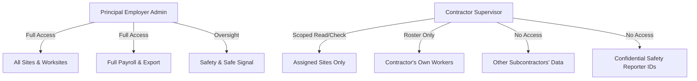

# FairShift Architecture Proposal — Contractor & Subcontractor Workforce Model

**Document Version:** 1.0.0  
**Status:** Architectural Recommendation (Deferred for V4.2 Implementation)  
**Target:** Multi-tier Contractor & Subcontractor Oversight in Construction & Industrial Facilities

---

## 1. Executive Summary & Problem Formulation

In large-scale infrastructure projects (e.g. metro rail construction, commercial high-rises, multi-facility university campuses), the frontline workforce is rarely employed directly by the principal owner. Instead, a **Principal Employer** contracts a **General Contractor (GC)**, who in turn engages multiple **Subcontractors / Labor Contractors** (e.g., rebar fabrication, formwork, electrical, masonry, cleaning).

A product benchmark review highlighted contractor-level grouping as an area for exploration. However, simply adding a naive `'contractor'` role to FairShift would violate core multi-tenant security guarantees without solving the real structural requirements of statutory compliance (e.g., BOCW Act and Contract Labour (Regulation and Abolition) Act, 1970).

This proposal outlines a defensible architectural path for multi-tier contractor management without compromising FairShift's database relational constraints, cryptographic receipts, or strict tenant isolation.

---

## 2. Current Architecture vs Multi-Tier Needs

| Architectural Dimension   | Current V4.1 Implementation                       | Multi-Tier Contractor Extension                                                     |
| :------------------------ | :------------------------------------------------ | :---------------------------------------------------------------------------------- |
| **Tenant Boundary**       | `organizations` table (`org_id`)                  | Principal Employer owns `organizations`; Subcontractors are scoped entities         |
| **User Hierarchy**        | `role IN ('worker', 'admin')`                     | Granular scoped role: `contractor_supervisor`                                       |
| **Site Scoping**          | Sites belong to an organization                   | Sites support multi-contractor presence                                             |
| **Attendance Visibility** | Admin sees all org shifts; Worker sees own shifts | Contractor supervisor sees only their assigned labor roster                         |
| **Payroll Isolation**     | Admin calculates organization payroll             | Subcontractor manages agreed piece-rate/hourly wages; Principal verifies compliance |

---

## 3. Proposed Relational Schema Design (V4.2 Target)

```sql
-- Subcontractor firms registered under a Principal Organization
CREATE TABLE IF NOT EXISTS contractors (
  id TEXT PRIMARY KEY,
  org_id TEXT NOT NULL REFERENCES organizations(id) ON DELETE CASCADE,
  name TEXT NOT NULL,
  registration_number TEXT NOT NULL DEFAULT '',
  contact_person TEXT NOT NULL,
  contact_phone TEXT NOT NULL,
  active INTEGER NOT NULL DEFAULT 1,
  created_at TEXT NOT NULL,
  UNIQUE (org_id, registration_number)
);
CREATE INDEX IF NOT EXISTS idx_contractors_org ON contractors(org_id, active);

-- Multi-site contractor deployment authorization
CREATE TABLE IF NOT EXISTS contractor_site_assignments (
  contractor_id TEXT NOT NULL REFERENCES contractors(id) ON DELETE CASCADE,
  site_id TEXT NOT NULL REFERENCES sites(id) ON DELETE CASCADE,
  assigned_at TEXT NOT NULL,
  PRIMARY KEY (contractor_id, site_id)
);

-- Worker association to contractor firm (additive migration)
-- ALTER TABLE users ADD COLUMN contractor_id TEXT REFERENCES contractors(id);
```

---

## 4. Authorization & Permission Boundary Matrix



1. **Roster Scoping**:
   - Contractor supervisors can only view workers whose `user.contractor_id = @contractorId`.
   - Attempting to check-in or correct a worker belonging to another contractor returns `403 FORBIDDEN`.
2. **Attendance Access**:
   - Site check-in validation requires the worker's contractor to have an active entry in `contractor_site_assignments` for that site.
3. **Payroll Visibility**:
   - Subcontractor supervisors cannot view the principal employer's total billing or rates paid to other subcontractors.
   - Wage records generated by subcontractors remain verifiable via FairShift Proof HMAC-SHA256 receipts.
4. **Safety & Zero Reporter Leakage**:
   - Safety reports filed on a worksite are visible to site supervisors for resolution; however, **confidential reports strictly suppress worker identity regardless of whether the viewer is a contractor supervisor or principal admin**.

---

## 5. Architectural Recommendation

> [!IMPORTANT]
> **Implementation Decision**: Do not introduce contractor roles or schema mutations in V4.1.  
> **Rationale**: Adding multi-tier RBAC requires updating every query in `src/server/repositories/` and introducing complex authorization middleware. Introducing this during the release candidate polish risks introducing privilege-escalation flaws.
> **Roadmap**: Retain this proposal as the designated architectural foundation for FairShift V4.2.
