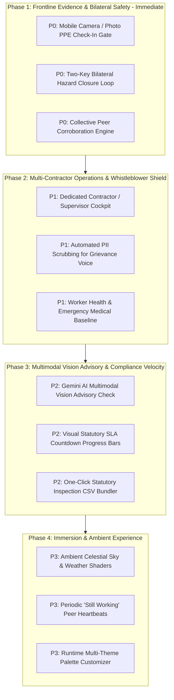

# FairShift Feature Gap Analysis & Prioritized Evolution Roadmap

**Document Reference**: `FAIRSHIFT_FEATURE_GAP_ROADMAP`  
**Base Architecture**: FairShift V4.1  
**Benchmark Source**: Product audit of a comparable frontline workforce application  
**Objective**: Prioritized technical roadmap translating the strongest frontline capabilities seen in the benchmark into FairShift's hardened cryptographic and privacy-first architecture without compromising security, privacy, or legal defensibility.

---

## 1. Prioritization Framework & Summary

Candidate capabilities discovered during the benchmark audit have been evaluated against FairShift's core mission: **workforce transparency, wage protection, and frontline safety (SDG 8)**.

| Priority Tier       | Description                                                                      | Key Additions                                                                                                                                        | Target Phase           |
| ------------------- | -------------------------------------------------------------------------------- | ---------------------------------------------------------------------------------------------------------------------------------------------------- | ---------------------- |
| **P0 — Critical**   | Fundamental worker safety, physical evidence, and retaliation defense            | • Mandatory Camera / Photo PPE Check-In Gate • Two-Key Bilateral Hazard Closure Loop • Collective Peer Corroboration Engine                    | Phase 1 (Next Release) |
| **P1 — High Value** | Significant operational efficiency, labor contracting parity, and PII protection | • Contractor / Site Supervisor Portal • Automated PII Redaction for Whistleblower Voice • Frontline Medical & Emergency Baseline Registry      | Phase 2                |
| **P2 — Useful**     | Visual audit convenience, AI advisory checks, and compliance velocity            | • Multimodal AI Vision Advisory on Hazard Remedies • Visual Statutory SLA Countdown Progress Bars • One-Click Statutory Inspection CSV Bundler | Phase 3                |
| **P3 — Optional**   | Aesthetic immersion and secondary interactions                                   | • Ambient Daylight / Atmospheric Theme Shaders • Periodic "Still Working" Peer Heartbeat Pulses • Runtime Multi-Theme Palette Selector         | Phase 4                |

---

## 2. Exhaustive 10-Point Feature Gap Analysis

Below is the rigorous 10-point analysis for every capability identified as missing or partially implemented in FairShift.

---

### GAP-01: Mandatory Camera / Photo PPE Check-in Gate (P0)

1. **What problem does it solve?**  
   Frontline workers frequently clock into dangerous work environments (substations, scaffoldings, biohazard wards) without wearing required protective equipment, leading to fatal workplace injuries. Paper or text check-ins provide zero physical evidence of compliance.
2. **Who benefits?**  
   Frontline workers (preventing fatal accidents), safety officers (verifiable proof of pre-shift readiness), and principal employers (protection against fraudulent liability claims).
3. **How does the benchmark product implement or present it?**  
   Renders a mandatory photo capture block on `/app`. The worker clicks "Click Camera Photo" (using `<input type="file" capture="user">`) or "Upload from Gallery". An image preview is rendered with a green monospace HUD overlay showing GPS coordinates and time. The "Confirm Shift Check-In" action is strictly disabled with a bouncing warning until the photo is attached.
4. **What would a FairShift equivalent look like?**  
   Integrate an accessible camera/gallery capture card directly into `Attendance.tsx` and `ShiftCard.tsx`. Upon capture, FairShift renders an SVG HUD watermark displaying the shift's HMAC-SHA256 receipt seed, latitude, longitude, and local timestamp. The shift creation payload includes the photo hash.
5. **What backend changes would be required?**
   - Update `shifts` table schema: add `ppe_photo_path TEXT`, `ppe_photo_hash TEXT`, `ppe_verified INTEGER DEFAULT 0`.
   - Add secure multipart upload endpoint `POST /api/worker/attendance/ppe-checkin` with MIME validation (JPEG/PNG/WebP only) and a strict 5MB payload ceiling.
   - Hash the image using SHA-256 and bind the digest directly into the shift's HMAC-SHA256 canonical receipt payload.
6. **What frontend changes would be required?**
   - Create `src/client/components/PpeCameraCapture.tsx` supporting HTML5 Camera API (`capture="user"`) and file upload.
   - Client-side EXIF stripping using an offscreen HTML5 `<canvas>` before upload to protect worker privacy.
   - Live camera preview container with instant HUD overlay.
7. **What external integrations would be necessary?**  
   None required. Utilizes native browser Media Capture API and local server storage (or Cloudflare R2 / S3 bucket in cloud deployments).
8. **What privacy or security risks exist?**
   - _Biometric & Facial Privacy_: Check-in photos contain worker faces. If exposed, this compromises worker privacy.
   - _Mitigation_: Store images in a private, non-public directory accessible only via authenticated admin sessions. Strip EXIF GPS metadata on the client, replacing it with the application's verified worksite coordinates.
9. **How difficult would implementation be?**  
   **Medium** (2-3 engineer days). Straightforward frontend file capture; backend requires storage management and database migration.
10. **What measurable value would it add?**  
    100% auditable visual compliance for all frontline shifts; immediate reduction in PPE non-compliance incidents.

---

### GAP-02: Two-Key Bilateral Hazard Closure Loop (P0)

1. **What problem does it solve?**  
   Site supervisors routinely mark dangerous workplace safety hazards as "Resolved" in software systems without actually fixing them on the ground ("paper compliance").
2. **Who benefits?**  
   Workers operating near dangerous equipment or open trenches; principal employers who face criminal liability when neglected hazards cause fatalities.
3. **How does the benchmark product implement or present it?**  
   When a hazard ticket is in review, closing the ticket requires two distinct keys:
   - _Key 1_: Supervisor must upload an "After-Remedy" photograph proving physical repair.
   - _Key 2_: The reporting worker or at least 2 peer corroborators must confirm resolution. The "I confirm, close ticket" button is disabled until both requirements are satisfied.
4. **What would a FairShift equivalent look like?**  
   Integrate the Two-Key requirement directly into FairShift's 7-stage Accountability Loop (`resolved` $\rightarrow$ `outcome_verified`). In `ReportDetail.tsx`, transition from `resolved` to `outcome_verified` is programmatically blocked unless an After-remedy photo is attached AND the reporting worker (or designated worker representative) signs off with their cryptographic session key.
5. **What backend changes would be required?**
   - Update `safety_reports` table schema: add `before_photo_url TEXT`, `after_photo_url TEXT`, `after_photo_hash TEXT`, `worker_signoff_at TEXT`, `worker_signoff_by TEXT`.
   - Update `src/server/services/reports.ts`: update state machine transition logic. A transition to `outcome_verified` rejects if `after_photo_url` is null or if the verifier is a supervisor rather than a worker/safety officer.
   - Generate an HMAC-signed closure certificate linking the Before photo hash, After photo hash, and worker signature.
6. **What frontend changes would be required?**
   - Update `ReportDetail.tsx` with a side-by-side **Before vs After Visual Comparison Card**.
   - Add supervisor After-photo upload widget.
   - Add worker verification action bar with status indicators for Key 1 (Photo) and Key 2 (Worker Sign-off).
7. **What external integrations would be necessary?**  
   None. Pure domain business logic and file storage.
8. **What privacy or security risks exist?**
   - _Tampered Evidence_: A supervisor could upload a generic stock photo of clean wiring instead of the actual repair.
   - _Mitigation_: Bind photo capture to the worksite geofence, record upload timestamp, and rely on the worker's manual physical inspection as the ultimate verification gate.
9. **How difficult would implementation be?**  
   **Low to Medium** (2 engineer days). Seamlessly extends FairShift's existing `outcome_verified` state machine stage.
10. **What measurable value would it add?**  
    Completely eliminates fictitious hazard closures across client worksites; establishes an immutable visual audit trail for regulatory inspections.

---

### GAP-03: Collective Peer Corroboration Engine (P0)

1. **What problem does it solve?**  
   Individual frontline workers who report safety hazards often face intimidation or termination by site supervisors. Conversely, supervisors frequently dismiss single-worker reports as exaggerated or isolated gripes.
2. **Who benefits?**  
   Frontline workers (strength in numbers, mutual protection), safety directors (clarity on which hazards represent recurring systemic dangers).
3. **How does the benchmark product implement or present it?**  
   Every open hazard in `/app/safety` features a "Corroborate Hazard" button. Any logged-in worker can tap the button to add their witness statement. When `corroboratorCount >= 2`, the hazard's severity is automatically elevated to `URGENT` under collective witness rules.
4. **What would a FairShift equivalent look like?**  
   In `WorkerReports.tsx`, open hazards in the worker's site display a "Corroborate" action. Corroborating logs a cryptographically signed witness event in the report's audit history. Reaching $\ge 2$ corroborations automatically triggers a severity elevation notification to the organization's Safety Director.
5. **What backend changes would be required?**
   - Create `safety_report_corroborations` table: `(id, report_id, worker_id, created_at, signature)`.
   - Add endpoint `POST /api/worker/reports/:id/corroborate`.
   - Update `src/server/services/reports.ts`: if corroboration count reaches threshold, execute an atomic state update escalating severity (`low`/`medium` $\rightarrow$ `high`/`critical`) and dispatch real-time admin alert.
6. **What frontend changes would be required?**
   - Add "Corroborate" button and witness badge counter to `WorkerReports.tsx` and `ReportDetail.tsx`.
   - Corroborator witness modal explaining collective witness protections.
7. **What external integrations would be necessary?**  
   None.
8. **What privacy or security risks exist?**
   - _Retaliation against Corroborators_: If supervisors see the list of corroborating workers, they can retaliate against the entire group.
   - _Mitigation_: Display only the **aggregate corroboration count** to supervisors and contractors. Restrict individual worker IDs to certified enterprise safety ombudsmen.
9. **How difficult would implementation be?**  
   **Low** (1-2 engineer days).
10. **What measurable value would it add?**  
    Transforms passive safety reporting into an active collective culture; surfaces neglected life-threatening hazards within hours.

---

### GAP-04: Contractor / Site Supervisor Cockpit (P1)

1. **What problem does it solve?**  
   In construction and infrastructure, principal employers hire third-party labor contractors who employ the frontline workers. FairShift currently only supports "Worker" and "Admin" roles, forcing contractors to either use full administrative privileges or share worker logins.
2. **Who benefits?**  
   Labor contractors, site engineers, sub-contractor managers, and enterprise procurement officers.
3. **How does the benchmark product implement or present it?**  
   A dedicated `/contractor` cockpit displaying multi-site workforce rosters, required skillsets per zone, shift reassignments, and a wage dispute review queue where contractors approve or reject worker discrepancy notices.
4. **What would a FairShift equivalent look like?**  
   Introduce a third core role: `contractor`. When authenticated, users access `/contractor` with scoped permissions: viewing only workers in their contractor pool, dispatching workers to authorized sites, reviewing wage discrepancies, and submitting attendance corrections.
5. **What backend changes would be required?**
   - Add `contractor` to `UserRole` union (`'worker' | 'contractor' | 'admin'`).
   - Add `contractor_id` foreign key to `users` and `shifts` tables.
   - Implement role-based access control (RBAC) middleware scoping contractor queries to `WHERE contractor_id = ?`.
   - Add dispute reconciliation endpoints: `POST /api/contractor/disputes/:id/approve` and `POST /api/contractor/disputes/:id/reject`.
6. **What frontend changes would be required?**
   - Create `src/client/pages/contractor/` containing `ContractorDashboard.tsx`, `ContractorRoster.tsx`, and `DisputeQueue.tsx`.
   - Navigation bar updates tailoring menu items for contractor sessions.
7. **What external integrations would be necessary?**  
   None.
8. **What privacy or security risks exist?**
   - _Cross-Contractor Data Leaks_: Contractor A must never see worker rates or records belonging to Contractor B.
   - _Mitigation_: Strict row-level security (RLS) enforcement in SQLite queries scoped to `authContext.contractorId`.
9. **How difficult would implementation be?**  
   **Medium to High** (4-5 engineer days).
10. **What measurable value would it add?**  
    Unlocks enterprise multi-contractor sales; enables general contractors to deploy FairShift across dozens of independent labor vendors.

---

### GAP-05: Automated PII Scrubbing for Whistleblower Voice (P1)

1. **What problem does it solve?**  
   Workers reporting sensitive grievances (sexual harassment, extortion, wage theft) often accidentally type their own names, phone numbers, or coworkers' identities into free-text descriptions, destroying their anonymity even when the platform suppresses user IDs.
2. **Who benefits?**  
   Vulnerable frontline workers, whistleblowers, and corporate compliance officers.
3. **How does the benchmark product implement or present it?**  
   Calls `/api/ai/transcribe-scrub` on submission, redacting phone numbers (e.g. `[phone redacted]`) and personal names using regex and NLP heuristics before the text enters storage.
4. **What would a FairShift equivalent look like?**  
   Integrate a deterministic PII sanitization pipeline into `feedback.ts` and `signal.ts`. When a worker submits a confidential report or SafeSignal entry, the server automatically sanitizes Indian phone numbers (`+91...`, `98765...`), Aadhaar-like 12-digit number formats, and common name prefixes before writing to the database.
5. **What backend changes would be required?**
   - Add `src/server/services/piiScrubber.ts` with regex rules for Indian mobile numbers, email addresses, and identification numbers.
   - Update `src/server/services/feedback.ts` and `reports.ts`: pipe `description` through `scrubPii()` prior to database insertion.
   - Retain an indicator `is_pii_scrubbed: 1` in the database record.
6. **What frontend changes would be required?**
   - Optional live client-side warning indicator in `Feedback.tsx` and `WorkerReportNew`: "Personal contact information detected and will be redacted to protect your identity."
7. **What external integrations would be necessary?**  
   None (regex-based) or optional private self-hosted NLP parser.
8. **What privacy or security risks exist?**
   - _Over-scrubbing_: Legitimate site codes or machine serial numbers could be mistakenly redacted.
   - _Mitigation_: Keep regex patterns strictly targeted to telephone numbers and national IDs; exclude internal site and equipment patterns.
9. **How difficult would implementation be?**  
   **Low** (1 engineer day).
10. **What measurable value would it add?**  
    Ironclad defense-in-depth against accidental whistleblower de-anonymization.

---

### GAP-06: Frontline Worker Health & Emergency Baseline Registry (P1)

1. **What problem does it solve?**  
   In industrial and construction accidents (falls, electrocution, collapse), first responders lose critical minutes attempting to identify an unconscious worker's blood group and emergency contact details.
2. **Who benefits?**  
   Frontline workers (emergency survival), on-site medical paramedics, and safety officers.
3. **How does the benchmark product implement or present it?**  
   Stores blood groups, age, height, weight, and emergency telephone numbers in worker profiles; surfaces them in the Admin "People" tab and live muster roll.
4. **What would a FairShift equivalent look like?**  
   Add an optional "Emergency Medical Baseline" card to the worker profile. In the Admin and Contractor Roster, emergency first-aid tags (Blood Group: O+, Emergency Contact: +91...) are immediately accessible upon clicking a worker's muster badge.
5. **What backend changes would be required?**
   - Update `users` table: add `blood_group TEXT`, `emergency_contact_phone TEXT`, `emergency_contact_name TEXT`, `allergies TEXT`.
   - Update `UserDTO` and `users.ts` repository.
6. **What frontend changes would be required?**
   - Add Emergency Medical card in `src/client/pages/worker/Home.tsx` and Admin `Workers.tsx`.
   - Red emergency medical badge on roster rows.
7. **What external integrations would be necessary?**  
   None.
8. **What privacy or security risks exist?**
   - _Medical Data Sensitivity_: Storing health data requires worker consent and strict access controls.
   - _Mitigation_: Fields must be strictly optional; accessible only to emergency safety officers, never shared with third-party advertisers.
9. **How difficult would implementation be?**  
   **Low** (1 engineer day).
10. **What measurable value would it add?**  
    Life-saving medical utility during severe construction or industrial accidents.

---

### GAP-07: Multimodal AI Vision Advisory on Hazard Remedies (P2)

1. **What problem does it solve?**  
   Safety officers inspecting hundreds of open hazard tickets across distributed infrastructure projects lack the time to physically inspect every minor repair.
2. **Who benefits?**  
   Enterprise safety inspectors and regional compliance managers.
3. **How does the benchmark product implement or present it?**  
   In the Two-Key modal, clicking "Run Gemini advisory vision comparison" posts Before and After photos to `/api/ai/vision-compare`, which returns `suggestedResolved: true`, confidence score (e.g. 0.92), and explanatory notes. Treated strictly as an advisory check.
4. **What would a FairShift equivalent look like?**  
   An optional "AI Advisory Inspection" button on `ReportDetail.tsx` (for admin/inspectors). FairShift submits the Before and After photo URLs to an official Gemini 2.0 Flash multimodal endpoint with an engineering prompt instructing it to identify physical changes, insulation, conduit repairs, or guardrail presence. The output renders as an advisory badge (`94% Confidence — Advisory Only`).
5. **What backend changes would be required?**
   - Create `src/server/services/visionAdvisory.ts` calling Google Gemini API (`gemini-2.0-flash`) via structured JSON schema.
   - Endpoint `POST /api/admin/reports/:id/ai-advisory`.
   - Store advisory result in `safety_reports.ai_advisory_json`.
6. **What frontend changes would be required?**
   - Add AI Advisory card in `ReportDetail.tsx` with clear non-binding disclaimer and confidence meter.
7. **What external integrations would be necessary?**  
   Google AI Gemini API key (`GEMINI_API_KEY`).
8. **What privacy or security risks exist?**
   - _Over-reliance & Hallucination_: An AI could falsely certify an unsafe repair as resolved.
   - _Mitigation_: System rules must forbid automated ticket closure based on AI verdicts alone. The human Two-Key sign-off remains mandatory.
9. **How difficult would implementation be?**  
   **Medium** (2 engineer days).
10. **What measurable value would it add?**  
    Assists overburdened safety teams in pre-screening repair quality across thousands of concurrent tickets.

---

### GAP-08: Visual Statutory SLA Countdown Progress Bars (P2)

1. **What problem does it solve?**  
   Workers and site supervisors find abstract MTTA/MTTR metrics hard to track on a daily basis. Without visible countdowns, hazard remediation deadlines are routinely missed.
2. **Who benefits?**  
   Site supervisors and frontline reporting workers.
3. **How does the benchmark product implement or present it?**  
   Every hazard ticket displays an animated countdown progress bar mapping statutory tiers (Supervisor: 0-4h, Safety Officer: 4-12h, Principal Employer: 12-24h) with explicit warnings (e.g. "Supervisor must inspect and upload photo within 2.3h").
4. **What would a FairShift equivalent look like?**  
   Add a dynamic `SlaCountdownBar` component to `ReportDetail.tsx` and `WorkerReports.tsx`. The bar color-codes time remaining (green $\rightarrow$ amber $\rightarrow$ red) and visually displays the current escalation tier.
5. **What backend changes would be required?**  
   None. Calculated client-side from `createdAt`, `status`, and industry SLA constants.
6. **What frontend changes would be required?**
   - Create `src/client/components/SlaCountdownBar.tsx`.
   - Embed countdown in hazard cards.
7. **What external integrations would be necessary?**  
   None.
8. **What privacy or security risks exist?**  
   None.
9. **How difficult would implementation be?**  
   **Low** (0.5 engineer days).
10. **What measurable value would it add?**  
    Improves SLA adherence by creating clear visual urgency for field supervisors.

---

### GAP-09: One-Click Statutory Inspection CSV Bundler (P2)

1. **What problem does it solve?**  
   When government labor inspectors visit worksites, safety officers waste hours manually compiling muster rolls, overtime registers, and wage sheets.
2. **Who benefits?**  
   HR managers, legal compliance teams, and field inspectors.
3. **How does the benchmark product implement or present it?**  
   The Admin "Compliance" tab provides instant download buttons for statutory CSVs: Muster Roll CSV, Overtime Register CSV, and Wage Discrepancy CSV.
4. **What would a FairShift equivalent look like?**  
   Add an "Inspection Pack" button in `src/client/pages/admin/Audit.tsx` and `PayRules.tsx`. One click generates a signed ZIP archive or individual CSVs containing Form A (Muster Roll), Form B (Wage Register), and Form C (Overtime Register) pre-formatted according to Indian labor rules.
5. **What backend changes would be required?**
   - Add `src/server/services/statutoryRegisters.ts` generating standardized Indian labor compliance tables.
   - Endpoint `GET /api/admin/compliance/export/:registerType`.
6. **What frontend changes would be required?**
   - Add export buttons to Admin Audit view.
7. **What external integrations would be necessary?**  
   None.
8. **What privacy or security risks exist?**
   - _Data Export Leakage_: Mass CSV exports contain full employee wage data.
   - _Mitigation_: Restrict export endpoints to certified administrators; log every export event in the immutable audit log.
9. **How difficult would implementation be?**  
   **Low to Medium** (1.5 engineer days).
10. **What measurable value would it add?**  
    Eliminates compliance audit preparation overhead; turns a 4-hour document search into a 5-second export.

---

## 3. Four-Phase Evolution Roadmap

### Phase 1: Frontline Evidence & Bilateral Safety (Immediate Priority)

- **Target**: Next minor release (V4.2).
- **Core Deliverables**:
  1. Add camera and photo upload capture (`PpeCameraCapture.tsx`) to shift attendance.
  2. Implement Two-Key closure verification (Supervisor After-photo + Worker confirmation) in `ReportDetail.tsx`.
  3. Implement peer corroboration button on open hazards with auto-escalation at $\ge 2$ witnesses.
- **Architectural Anchor**: Bind photo SHA-256 hashes directly into FairShift's existing HMAC-SHA256 work receipts and Merkle tree roots.

### Phase 2: Multi-Contractor Operations & Whistleblower Shield

- **Target**: V4.3.
- **Core Deliverables**:
  1. Introduce the `contractor` user role and `/contractor` cockpit for labor sub-contractors.
  2. Implement automated regex PII scrubbing on all grievance and SafeSignal reports.
  3. Add frontline emergency medical baselines (blood groups, emergency phones) to worker profiles.

### Phase 3: Multimodal Vision Advisory & Compliance Velocity

- **Target**: V4.4.
- **Core Deliverables**:
  1. Integrate Google Gemini 2.0 Flash multimodal vision endpoint for advisory Before/After repair analysis.
  2. Add visual SLA countdown progress bars with statutory tier markers.
  3. Build one-click Indian statutory labor CSV register generator (Forms A, B, C).

### Phase 4: Immersion & Ambient Experience

- **Target**: Future considerations.
- **Core Deliverables**:
  1. Optional ambient sky effects reflecting real-time heat conditions (amber for heatwaves, obsidian for night shifts).
  2. Periodic peer consensus "Still Working" heartbeats for decentralized shift corroboration.
  3. High-contrast / Amber CRT theme toggle for varying job-site lighting conditions.
